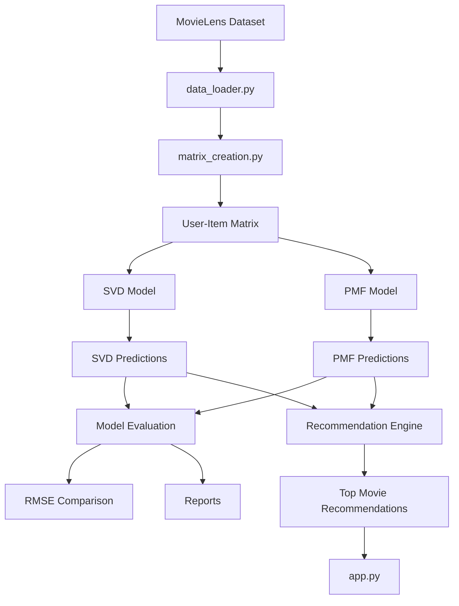
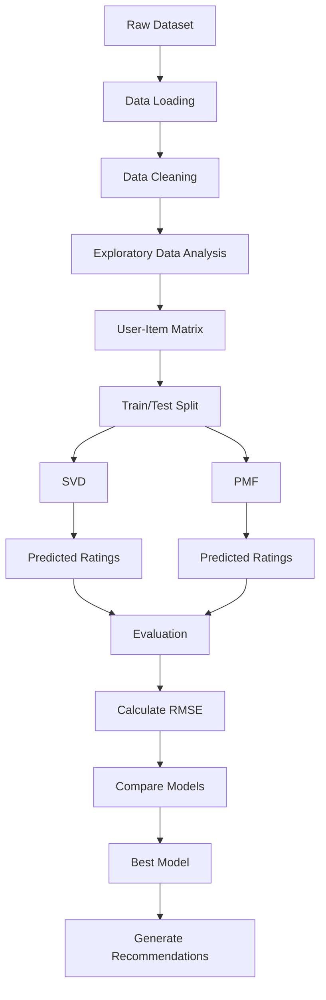

# Matrix Factorization Movie Recommender

## Architecture

### This diagram shows how your files communicate with each other

### This diagram focuses on the machine learning pipeline.

## Preparing the user-item matrix

Run `python utils/matrix_creation.py` from the repository root to load the
MovieLens data, split ratings into training and test sets, and create a
user-item matrix from the training ratings. The matrix is centered by each
user's mean rating, and missing ratings are represented as `0` after
normalization. The result is saved to `processed/user_item_matrix.csv`.

See the [project documentation](doc/README.md) for setup instructions,
repository structure, data details, and the current workflow.
