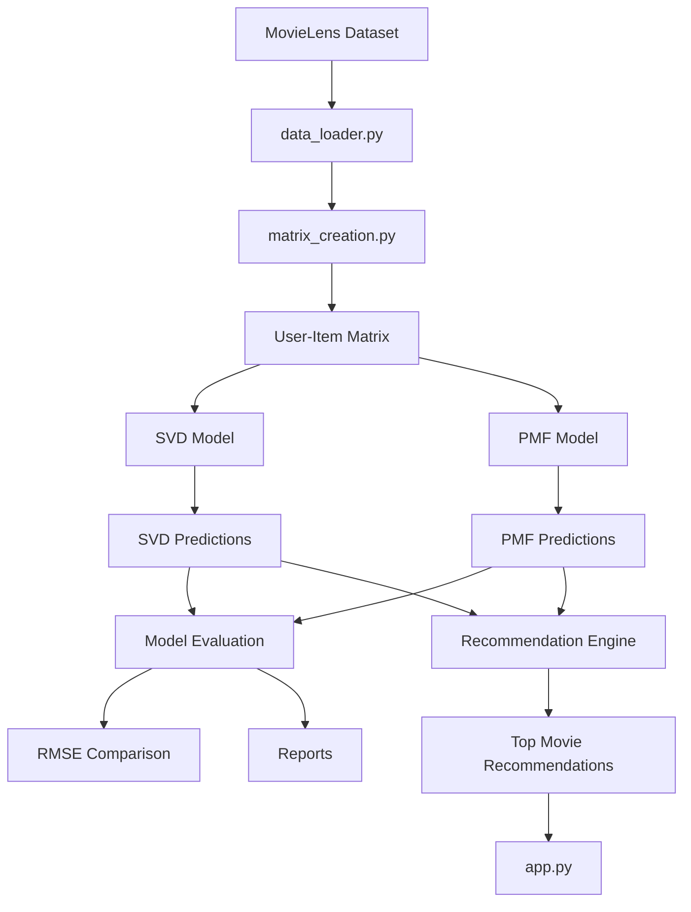
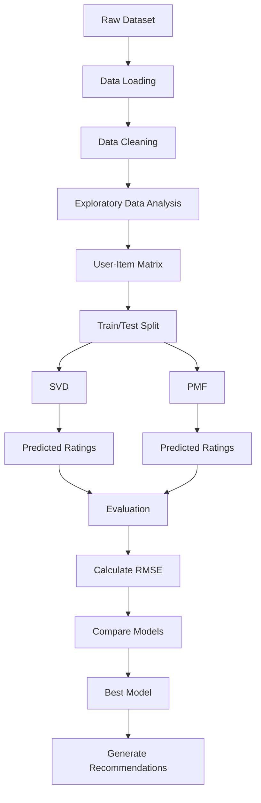

# Matrix Factorization Movie Recommender

## Architecture

### This diagram shows how your files communicate with each other


### This diagram focuses on the machine learning pipeline.




## Preparing the user-item matrix

Run `python utils/matrix_creation.py` from the repository root to load the
MovieLens data, split ratings into training and test sets, and create a
user-item matrix from the training ratings. The matrix is centered by each
user's mean rating, and missing ratings are represented as `0` after
normalization. The result is saved to `processed/user_item_matrix.csv`.

## Train and evaluate SVD

First generate the processed training matrix, then train and evaluate SVD from
the repository root:

```bash
python utils/matrix_creation.py
python -m models.svd_model
```

SVD loads `processed/user_item_matrix.csv` as its factorization input. The
matrix-creation step uses an 80/20 split with `random_state=42` and centers
ratings using each user's training-set mean. SVD fits a rank-50 factorization
with `scipy.sparse.linalg.svds`, adds the training means back to reconstructed
ratings, clips predictions to the 1–5 rating scale, and computes RMSE only on
observed test ratings. The full prediction matrix is saved as a compact
`float32` NumPy array in `reports/svd_predictions.npy`; the test RMSE is written
to `reports/model_metrics.json`.

## Train and evaluate PMF

After generating the processed matrix, run:

```bash
python -m models.pmf_model
```

PMF trains on observed ratings from the same fixed-seed training split (not on
zero-filled missing cells). It writes per-epoch training MSE to the console,
saves the convergence curve and latent factors under `reports/`, and adds its
test RMSE to `reports/model_metrics.json`.

## Generate recommendations

Use the shared recommendation function after training the desired model:

```python
from utils.recommendation import (
    generate_recommendations,
    save_user_recommendations,
)

top_movies = generate_recommendations(user_id=1, model="pmf", top_n=10)
print(top_movies)
```

Set `model` to `"svd"` or `"pmf"`. Already-rated movies are excluded, and each
result includes the movie ID, title, genres, and predicted rating. To save a
user's top recommendations from both models as
`reports/user_<id>_recommendations.csv`, use
`save_user_recommendations(user_id=1, top_n=10)`.

## Generate comparison plots

After training both models, run:

```bash
python -m utils.model_visualization
```

This evaluates both prediction matrices on the same held-out split and creates
`predicted_vs_actual.png`, `rmse_comparison.png`, `user_comparison.png`, and
`top_recommendations.png` in `reports/`. The selected user defaults to ID 1;
call `generate_model_visualizations(user_id=..., top_n=...)` to choose another.

## Run the Streamlit dashboard

After training both models and generating the processed matrix, launch the
interactive dashboard from the repository root:

```bash
streamlit run app.py
```

Enter a MovieLens user ID to view their highest-rated movies, top SVD and PMF
recommendations, and a visual comparison of predicted ratings. The dashboard
shows a helpful message if the model prediction files have not been generated.

## Explore the project notebook

Open `Movie_Recommender_System.ipynb` in Jupyter or VS Code after generating
the processed matrix and both model prediction files. The notebook summarizes
the MovieLens data, examines rating distribution and matrix sparsity, evaluates
both models on the fixed test split, and compares recommendations for a sample
user.

Review `data/README` for the MovieLens dataset description and usage terms.
